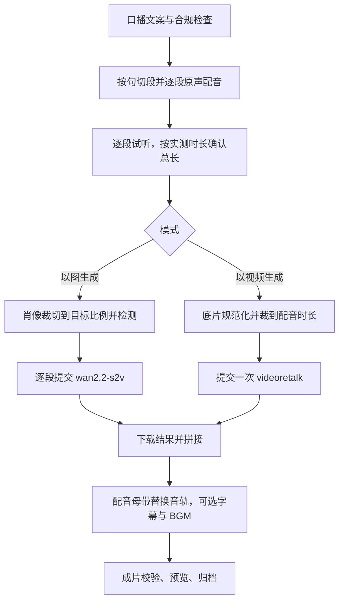

# 数字主播 Agent 方案

日期：2026-10-21。状态：设计方案，尚未实施，未调用付费模型。网关渠道尚未接入，本文假定网关会提供 `wan2.2-s2v` 与 `videoretalk`；接口约定以网关接入后的实测为准。供应商能力与价格按本文日期核对官方文档，口型效果仍需样片评测。

上位资料：[配音、字幕与对口型方案](marketing-video-audio-subtitle-plan-20261020.md)（第 3 节对口型路径）、[TTS 配音计划](marketing-video-tts-narration-plan-20261020.md)。

## 1. 定位与边界

数字主播是独立的创作 Agent，用数字分身的**原声**生成真人主播口播视频，提供两种模式：

| 模式 | 输入 | 供应商 | 适用 |
| --- | --- | --- | --- |
| 以图生成 | 一张人物肖像 + 原声配音 | 万相 `wan2.2-s2v`（图片 + 音频驱动） | 没有拍摄素材，快速出主播讲解 |
| 以视频生成 | 一段口播底片 + 原声配音 | `videoretalk`（视频口型替换） | 已有实拍底片，保留真实动作和场景，只换口型与台词 |

和营销影像的分工：

| | 营销影像 | 数字主播 |
| --- | --- | --- |
| 时间轴由什么决定 | 分镜，视频模型逐镜生成画面 | 配音，画面跟着配音走 |
| 声音 | AI 配音（参考音色）；数字分身旁白（已上线，画外 TTS 原声，人物不对镜头念台词） | 只用数字分身已复刻的原声 |
| 画面 | 场景、产品、运镜自由编排 | 单人正脸近景，基本不换场景 |

营销影像第 3 步只保留「AI 配音」「数字分身旁白」两种配音方式，已去掉「数字分身口播」。营销影像 Agent 的描述目前写着「主播宣传演讲视频」。数字主播上线时再决定是否把它改为侧重探店与产品宣传，并在营销影像里加一行「需要真人对口型？前往数字主播」的入口。

首版不做：多人对话、换装 / 换场景、画中画产品展示、实时直播、文本驱动由供应商另合成声音（会破坏原声一致性）、抖音直发。

## 2. 供应商能力核对

### 2.1 wan2.2-s2v（以图生成）

依据：[万相数字人 API](https://help.aliyun.com/zh/model-studio/wan-s2v-api)、[图像检测 API](https://help.aliyun.com/zh/model-studio/wan-s2v-detect-api)。

- 仅华北 2（北京）地域。异步任务：提交返回 `task_id`，轮询状态 `PENDING / RUNNING / SUCCEEDED / FAILED / UNKNOWN / CANCELED`，官方示例间隔 15 秒，通常 5–10 分钟出结果。
- 输入：`image_url`（jpg / jpeg / png / bmp / webp，宽高各 400–7000 像素，比例不限，输出沿用输入比例）、`audio_url`（wav / mp3，小于 15 MB，**时长小于 20 秒，超过直接失败**，需清晰人声、无噪声和背景音乐）、`resolution` `480P`（默认）/ `720P`。
- 输出：视频时长等于音频时长；720P 约 92 万像素（随比例调整），示例帧率 16 fps；`video_url` **24 小时后失效**。
- 计费：按成功生成的视频秒数，480P 0.5 元/秒，720P 0.9 元/秒；失败不计费。
- 图像检测 `wan2.2-s2v-detect`：返回 `check_pass` / `humanoid`，按张计费，检测不通过也收费。用户未提到网关提供该模型，见第 8 节。

### 2.2 VideoRetalk（以视频生成）

依据：[VideoRetalk API](https://help.aliyun.com/zh/model-studio/videoretalk-api)、[产品说明](https://help.aliyun.com/en/model-studio/videoretalk/)。

- 仅华北 2（北京）地域。异步任务，状态多了 `PRE-PROCESSING / POST-PROCESSING`。
- 视频：mp4 / avi / mov，≤ 300 MB，**2 秒 < 时长 < 120 秒**，15–60 fps，边长 640–2048，推荐 H.264 / H.265；人物正面近景，避免大角度侧脸和人脸过小。
- 音频：wav / mp3 / aac，≤ 30 MB，2 秒 < 时长 < 120 秒，清晰人声、无噪声和背景音乐。
- 可选 `ref_image_url` 指定目标人脸（单人正脸，≤ 10 MB，长宽比 ≤ 2），`query_face_threshold` 120–200。只替换一个人物；没有参考图时取画面中占比最大的人脸。
- **时长不一致的行为**：默认按较短者截断；音频更长且 `video_extension=true` 时用「倒放-正放」循环补画面。音频静音段人物闭嘴；无人脸的画面保持原样。
- 输出分辨率和帧率与输入视频一致，`video_url` 24 小时后失效，按 `usage.video_duration` 计量。官方说明页价格为 0.08 元/秒；限流为提交 1 RPS、并发 1 个任务，其余排队。

### 2.3 原声配音

沿用已接入的 `digital-twin/voices.ts → TwinVoices.speak`：只从 `digital_twin_voices` 读取状态为 `OK` 的音色 ID 及其绑定的 `qwen-audio-3.0-tts-plus`，用当前用户的 New API Key 调 `OPENAI_BASE_URL/audio/speech`，网关计费，不重试。网关阿里渠道必须和 `QWEN_VOICE_API_KEY` 属于同一千问账号，否则音色 ID 不可用。TTS 输出干净人声，正好满足两家供应商对音频的要求。

## 3. 制作流程



界面沿用营销影像的三步结构，便于用户迁移：

1. **口播文案**：输入主题生成，或粘贴已有文案；选择目标时长（首版 15–60 秒）；生成前自动做合规检查。
2. **形象与声音**：选择模式（以图生成 / 以视频生成）；从数字分身肖像库选择或上传肖像，或者上传口播底片；从数字分身语音库选择**已复刻完成**的音色（未复刻的样例不可选，提示先去数字分身复刻）；设置语速和语气说明。
3. **配音试听与生成**：一键合成全部配音并逐段试听；显示实测总时长、预计生成时长和预计耗时；确认后提交生成；结果页提供预览、下载，以图模式支持单段重做。

### 3.1 文案与配音

- 文案生成复用营销影像的文案链路（`AgentService.marketingText`，用户凭证的 `kimi-k3`，`upstreamBilling`），换成口播专用提示词：第一人称、单人讲解、短句、不写画面指令。
- 合规检查复用 `marketing-video/compliance.ts` 的风险表与模型审核。它现在直接读取营销草稿字段，需要先把输入改成「字段名 → 文本」的通用结构，营销影像按原样传入，避免复制一套规则。
- **按句子逐段合成**：每段由一句或几句组成，以图模式每段目标不超过 15 秒（供应商上限 20 秒，留出语速误差）。逐段合成有三个好处：
  - 每段音频天然满足 s2v 时长上限，不需要切音频；
  - 每段实际时长就是句级时间轴，字幕不需要强制对齐；
  - 改一句只需重配该段。
  代价是段与段之间的语气衔接弱于整段合成，作为已知限制，在试听时可感知。
- 单句估计超过 15 秒时提示用户拆句，不自动改写。全片实测时长超出目标范围时，提示调整语速或精简文案，不自动大幅变速。
- 配音以「文本 + 音色记录版本 + 目标模型 + 语速 + 语气」的哈希为键保存到私有存储，未改动的段不再重复付费合成。

### 3.2 以图生成

- 肖像先在本地按目标画面比例（9:16 / 16:9 / 1:1）居中裁切并缩放到 400–7000 像素范围，因为输出沿用输入比例。裁切预览在第 2 步显示，用户可调整取景。
- 每段提交一次 `wan2.2-s2v`：`image_url` 为同一张裁切图，`audio_url` 为该段配音，默认 `720P`。
- **段间跳切**：每段都从同一张图起步，拼接处人物姿态会突然复位。首版处理办法：
  1. 段间做 0.2–0.3 秒交叉淡化；
  2. 按段交替使用原始取景和轻微推近的取景（本地裁切，不额外付费），让切换看起来像剪辑节奏。
  效果需在样片评测中确认，不达标时考虑把段长放宽到接近 20 秒，以减少切点。
- 输出最高约 720p，界面不提供 1080p 选项，也不宣称原生高清。

### 3.3 以视频生成

- 底片在付费前做本地检查和规范化：
  - 格式、大小、时长、帧率、边长都不满足时直接拦截并提示原因；
  - 能修正的（编码、帧率、超过 2048 的边长）用 FFmpeg 转成 H.264 MP4；
  - 去掉底片原有音轨。
- **底片必须不短于配音**。提交前把底片裁到配音时长再提交，从而绕开供应商的默认截断。不使用 `video_extension` 的倒放循环，因为口播场景中倒放动作明显不自然。底片不够长时提示用户补拍或精简文案。
- 配音整段（逐段配音按停顿拼接后的母带）不超过 120 秒，一次提交即可。首版不做以视频模式的单段重做；底片内容变化后整片重做。
- 多人画面需要用户指定目标人脸：从数字分身肖像库选一张作为 `ref_image_url`，或在底片中截一帧。单人底片不需要。
- 输出分辨率跟随底片。界面按底片实际分辨率说明，不额外提供清晰度选项。

### 3.4 合成

复用 `marketing-video/media.ts` 的探针、编码规范化和拼接：

- 拼接后用本地配音母带替换供应商返回的音轨，保证全片原声一致，也避开供应商二次编码。
- 可选字幕（阶段 C）：内容取自确认文案，时间取自逐段配音的实测时长；烧录需要 libass 和固定中文字体，沿用 `mediaCapabilities` 在付费前探测。
- 可选 BGM 压低混入。
- 成片校验总时长与配音母带一致，并抽帧检查画面非空。

## 4. 数据与接口

### 4.1 Agent 与前端入口

| 位置 | 改动 |
| --- | --- |
| `core/agents/types.ts`、`core/agents/definitions/digital-presenter.ts`、`index.ts` | 新增 `digital_presenter`，名称「数字主播」，分类「创作」，空工具白名单（生成走鉴权任务接口，不经 LLM 工具） |
| `server/services/agent-service.ts` | 注册定义；文案请求沿用 `marketingText` 的超时、截断检查和错误码 |
| `web/components/ChatPanel.tsx`、`pages/Workspace.tsx`、`lib/agent-icons.tsx`、`lib/agent-order.ts` | 打开 Agent 时渲染 `DigitalPresenterStudio`；图标与排序；中英印尼文案 |
| `web/modules/digital-presenter/` | 三步界面；复用 `marketing-video` 的 `ConfirmDialog`、`WaitStatus`、`TaskStatus`、`ReviewPanel`，以及数字分身的 `DigitalTwinPicker` |

### 4.2 草稿

`core/digital-presenter/index.ts` 定义严格 schema，按用户保存为 JSONB：

```ts
DigitalPresenterDraftSchema = z.object({
  topic: z.string().max(800).default(""),
  script: z.string().max(2000).default(""),
  durationSec: z.number().int().min(15).max(60).default(30),
  mode: z.enum(["image", "video"]).default("image"),
  /** 数字分身声音条目 ID；只接受已复刻、状态 OK 的音色。 */
  voiceItemId: z.string().uuid().optional(),
  speed: z.number().min(0.8).max(1.25).default(1),
  instructions: z.string().trim().max(200).default(""),
  /** image：肖像；video：口播底片，可附目标人脸。 */
  portrait: z.string().uuid().optional(),
  baseVideo: z.string().uuid().optional(),
  faceReference: z.string().uuid().optional(),
  ratio: z.enum(["9:16", "16:9", "1:1"]).default("9:16"),
  resolution: z.enum(["480P", "720P"]).default("720P"),
  subtitles: z.boolean().default(false),
  music: z.string().uuid().optional(),
  musicVolume: z.number().min(0).max(0.5).default(0.12),
  /** 句段与对应配音资产；文本变化即失效。 */
  segments: z.array(z.object({ text: z.string(), audio: z.string().uuid().optional(), durationMs: z.number().int().optional() })).default([]),
}).strict();
```

底片和肖像的上传沿用 `routes/uploads.ts`，新增 `purpose=digital-presenter`，私有存储，校验归属、文件签名和大小。口播底片首版只存在本 Agent 的素材里；之后如果用户需要在多个草稿里复用，再考虑并入数字分身库（新标签 `digital-twin:video`）。

### 4.3 数据库（新迁移 `0056-digital-presenter.ts`；55 已用于营销影像的旁白记录）

- `digital_presenter_projects`：用户、草稿 JSONB、版本号、时间。
- `digital_presenter_audio`：项目、段序号、配音哈希、资产 ID、实测毫秒数、网关请求 ID、状态。
- 制作任务沿用 `tasks` 表与 BullMQ，新增独立队列 `lot-digital-presenter`；父任务冻结输入快照（模式、模型 ID、配音资产与哈希、裁切参数、`inputVersion: 1`）。
- `digital_presenter_clips`：父任务、段序号、供应商模型、外部任务 ID、状态（`pending → submitting → running → succeeded / failed / unknown`）、结果资产、实际计量秒数、释放次数。

### 4.4 接口

| 接口 | 作用 |
| --- | --- |
| `GET/POST/PUT/DELETE /api/digital-presenters[/:id]` | 草稿增删改查、分页搜索 |
| `POST /:id/copy`、`POST /:id/review` | 生成文案、合规检查（复用文案类请求的回执与恢复机制） |
| `POST /:id/speech` | 合成全部未缓存的段配音，按段返回结果 |
| `POST /:id/generate` | 付费前校验后创建父任务和片段任务，幂等投递 |
| `GET /:id/task`、`POST /:id/cancel`、`POST /:id/continue`、`POST /:id/unknown-clips/release` | 进度、取消、继续失败段、用户确认后重提未知段 |
| `POST /:id/revise` | 以图模式单段重做，其余段复用原资产 |
| `GET /api/digital-presenters/capabilities` | 下发可用模式、清晰度与各项上限；渠道未配置时对应模式不可选 |

### 4.5 网关调用约定（待网关接入后确认）

假定沿用现有 OpenAI 兼容 `/videos` 接口，由网关适配到百炼：

| 模型 | 请求字段 | 说明 |
| --- | --- | --- |
| `wan2.2-s2v` | `input_reference` = 肖像 URL，`reference_audio` = 段配音 URL，`size` 或 `metadata.resolution` = `720P` | 不传 `prompt` 时网关需允许 |
| `videoretalk` | `reference_video` = 底片 URL，`reference_audio` = 配音 URL，可选 `input_reference` = 目标人脸，`metadata.video_extension=false` | 默认截断行为不可依赖，本地已对齐时长 |

需要网关确认：

- 字段映射是否如上；
- 查询接口是否透传 `FAILED` 的错误码；
- 计量秒数是否按 `usage.duration` / `usage.video_duration` 计；
- 结果 URL 的有效期；
- 是否支持取消 `PENDING` 任务；
- 是否提供 `wan2.2-s2v-detect`。

在 `core/providers/video-generation.ts` 新增两个适配器，或在 `OpenaiVideoAdapter` 中按模型分支，错误统一经 `provider-error.ts` 收敛，不回显供应商自由文本。

## 5. 计费、恢复与安全

- **计费只走网关**：TTS、文案、检测和视频都用当前用户的 New API Key，由网关账号计费，本地不新增计量或金额计算。界面只展示「预计生成 X 秒」；网关有价格配置时再显示预估费用。
- **付费请求先落意图**：持久化外部请求意图后再提交；结果未知只查询，不自动重发。网关未返回任何内容（无响应 ID、正文和用量）的失败按未计费处理，用户可直接重试；偶发扣费凭网关请求 ID 核对退费。
- **结果 24 小时失效**：成功后立即下载到私有存储再标记成功；Worker 长时间停摆导致结果过期时，状态置为「结果已过期」，由用户确认后重新生成（会再次计费）。
- **临时链接时效**：营销私有素材的公网临时链接现为 10 分钟（`generation/private-materials.ts`）。供应商并发只有 1，任务可能排队超过 10 分钟后才下载输入，所以需要：
  1. 网关确认供应商是在提交时还是开始运行时下载输入；
  2. 必要时为本队列单独延长有效期（例如 2 小时），或在本地排队，确认供应商空闲后再提交。
  不能把私有素材改成长期公开。
- **取消**：停止轮询和后续提交；已提交的段可能仍会计费，确认框中如实说明。
- **吞吐**：VideoRetalk 官方限流为并发 1，s2v 单段 5–10 分钟。60 秒以图视频约 4–5 段，排队串行时可能需要 20–50 分钟。因此：
  - 队列默认全局并发 1、每用户 1；
  - 界面显示排队位置和已用时，完成后发通知；
  - 上线前向网关确认能否申请更高并发。
- **安全**：沿用归属校验、文件签名与大小校验、SSRF 防护（供应商只读本服务签发的临时链接）、输入 schema 校验和取消信号。肖像和音色只能用于本人上传或本人授权的素材。在第 2 步加授权确认，不提供「用他人照片 / 声音」的引导。

## 6. 实施顺序

| 阶段 | 交付 | 完成标准 |
| --- | --- | --- |
| A：骨架与以视频生成 | Agent 入口、草稿、文案与合规、逐段原声配音与试听、底片规范化、VideoRetalk 单任务、音轨替换、结果预览下载、恢复与取消 | mock 全流程通过；真实渠道接通后 10 条样片口型和原声验收通过 |
| B：以图生成 | 肖像裁切与检测、s2v 逐段生成、段间过渡、单段重做 | 段间跳切观感经样片评审可接受；单段失败可只重做该段 |
| C：完善 | 字幕烧录、BGM、发布标题标签、归档到私有知识库、营销影像跳转入口 | 字幕时间与配音一致；归档和复制为新草稿可用 |

先做以视频生成，原因有三：

- 单次任务链路最短，能先跑通「原声配音 → 对口型 → 合成」的公共部分；
- 单价约为 s2v 720P 的 1/11，评测成本低；
- 不涉及跳切问题。

以图生成在公共部分稳定后接入。

## 7. 验收

用同一批已授权素材比较：每种模式至少 20 条，覆盖 15 / 30 / 60 秒、品牌多音字、数字价格、中英混读、正脸与轻微转头，并包含以视频模式的多人画面。记录以下指标：

- 错读率；
- 口型偏移（人工标注 P95 目标 ≤ 100 毫秒）；
- 牙齿与嘴部形变；
- 身份保持；
- 段间跳切观感；
- 成功率、端到端耗时、实际计量秒数。

故障模拟：

- TTS 断流；
- 提交后网关无响应；
- Worker 重启；
- 结果 URL 过期；
- 取消；
- 用户在生成中修改文案。

确认不会重复提交未知付费请求，成功段可复用。

## 8. 待确认事项

1. 网关两个渠道的字段映射、错误码透传、计量口径、结果有效期和取消支持（第 4.5 节）。
2. 网关是否提供 `wan2.2-s2v-detect`。不提供时跳过检测：s2v 失败不计费，失败后提示更换肖像即可；代价是用户多等一次任务时间。
3. 网关阿里渠道是否与千问音色复刻属于同一账号（原声配音的前提）。
4. 供应商并发上限能否提升，决定是否要在界面上提示长时间排队。
5. 营销影像 Agent 描述是否调整，以及是否加跳转入口（第 1 节）。

本次仅核对现有代码、官方文档与本地引用，未接入渠道、未做真实生成评测，也未变更运行时代码。
