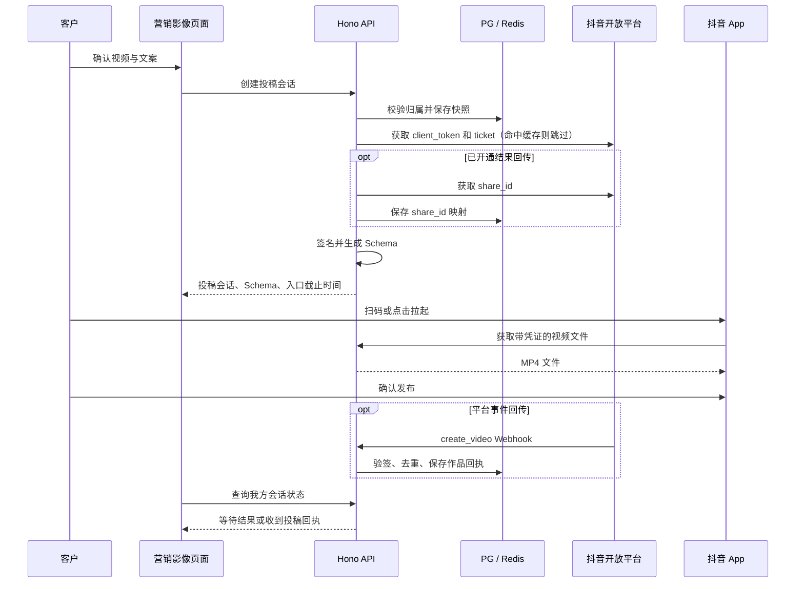

# 营销影像接入抖音 H5 投稿方案

状态：设计方案，尚未实现，未调用真实投稿接口。文档核查日期：2026-10-21，核查记录见[第 11 节](#11-文档核查记录)。

## 0. 先决条件：能力准入（未通过前不开发）

[能力使用规范](https://partner.open-douyin.com/docs/resource/zh-CN/dop/operation-standard/platform-capabilities/useclue)对投稿能力（SDK 投稿和 H5 投稿）有明确限制。营销影像的定位与这些限制直接冲突：

| 规范要求 | 与本产品的关系 |
| --- | --- |
| 投稿只开放给创作工具、社区、硬件伴侣、游戏类应用，其他类型暂不支持 | Lot Agent 需以"创作工具"类通过审核，结果未知 |
| 不对个体工商户开放；企业主体注册资本不低于 50 万、成立满一年 | 需核对运营主体 |
| 企业宣传、商品介绍、诱导分享等营销类内容分享，不开放准入 | 营销影像生成的正是店铺介绍和产品宣传视频 |
| 禁止发布商铺宣传、商品介绍、诱导分享等营销类内容，禁止用水印导流 | 同上；成片也不能加导流水印 |
| 投稿用户必须是内容的原创作者；内容应与抖音原生内容无明显差异 | 客户本人账号发布、客户确认的内容可满足；需在弹窗中说明 |
| 违规或连续 90 天无投稿 / 分享，平台可回收能力 | 上线后需有真实使用量 |

结论：准入风险高。开始编码前，必须先用营销影像的真实用途和样片在控制台申请"发布内容至抖音"和"H5 场景"，并取得书面批准。只开通 H5 场景无法发布内容。不能为绕过限制改用"转发到日常"（`share_to_type=1`），规范同样禁止诱导分享明显营销感的内容。

未获批时保持现状：结果页提供下载视频和复制标题标签，由客户在抖音手动发布。

### 0.1 AI 生成内容标识

营销影像的成片由 AI 生成。抖音要求发布者对 AI 生成内容主动声明，发布页可选"内容由 AI 生成"；《人工智能生成合成内容标识办法》自 2025-09-01 施行，对生成服务提供者有显式和隐式（元数据）标识要求。H5 Schema 没有声明 AI 生成的参数（见第 5.2 节参数表）。

- 投稿弹窗和下载入口都提示：请在抖音发布页声明"内容由 AI 生成"。
- 成片是否需要由本系统写入隐式标识（元数据），需法务确认。这项要求与 H5 无关，下载发布同样适用，建议单独立项。
- 以上规则来自二手报道（[IT 之家](https://www.ithome.com/0/879/586.htm)、[中国法律译站](https://www.chinalawtranslate.com/抖音关于人工智能生成内容标识的水印与元数据规/)），以抖音安全与信任中心公示版本为准。

## 1. 产品目标与范围

营销影像生成成片后，客户在 Lot Agent 点击「发布到抖音」。PC / Electron 显示二维码，客户用抖音扫码进入发布页，检查手机当前账号、文案和视频后发布。移动网页由用户点击按钮，通过 Schema 拉起抖音。功能基于网站应用的 H5 投稿能力。[官方 H5 文档](https://developer.open-douyin.com/docs/resource/zh-CN/dop/develop/sdk/web-app/h5/share-to-h5)

首版只投稿单条成片。系统准备素材、签名和投稿入口，客户在抖音完成发布。可以后续扩展预约提醒，但不能用 H5 Schema 在后台到点自动发布。

H5 参数没有指定目标账号的 open_id，实际发布账号是手机中当前登录的抖音账号。扫码弹窗明确提示「请先在抖音切换到需要发布的账号」。首版不要求客户先完成抖音 OAuth 账号绑定。以后增加账号绑定时，可以用回调中的 `from_user_id`（open_id）核对账号，但不能强制抖音切换账号，也不能撤回已经发生的串号发布。

## 2. 开通与部署准备

必需能力（以控制台实际获批为准）：

| 能力 | Scope | 用途 |
| --- | --- | --- |
| H5 场景 | `h5.share` | H5 / 扫码拉起发布 |
| 获取 open_ticket | `open.get.ticket` | Schema 签名票据 |
| 投稿 | `aweme.share` | 抖音 30.5.0 及以上需在 `h5.share` 之外单独申请；30.5.0 以下只需 `h5.share` |
| 转发到日常 | `aweme.forward` | 本方案不用于发布；`/share-id/` 和 `create_video` 事件列的 Scope 是它，事件表标注默认开通 |

客户端最低版本（文档标注）：进入发布页（`share_to_publish=1`）需 Android 20.8.0、iOS 21.5.0；`title`、`title_hashtag_list` 需 22.2.0；`share_to_type` 需 25.4.0；`short_title`、`private_status`、`download_type` 需 30.0.0。

建议的服务端配置：

```dotenv
DOUYIN_H5_ENABLED=0
DOUYIN_CLIENT_KEY=
DOUYIN_CLIENT_SECRET=
DOUYIN_SHARE_CALLBACK_ENABLED=0
DOUYIN_SHARE_UI_TTL_SECONDS=600
DOUYIN_SHARE_MEDIA_TTL_SECONDS=5400
# 复用现有公网基址配置；必须能被手机和抖音下载服务访问
PUBLIC_BASE_URL=https://app.example.com
```

两个 TTL 是本方案的建议值，不是平台保证的二维码有效期。回调模式下，入口截止时间取产品 TTL、票据剩余寿命和 share_id 剩余寿命（1 小时）中的最小值，并留出安全余量。媒体有效期覆盖扫码、下载、编辑和重试，与弹窗倒计时无关。

准备 HTTPS 媒体域名和可接收公网 POST 的 Webhook 地址，并按控制台要求完成应用配置。业务 API 继续要求 Lot Agent 登录，媒体入口和 Webhook 各自验证。生产和测试使用不同的应用：文档警告，上线后在测试环境使用生产 `client_key` / `client_secret` 会使生产 client_token 失效。凭证不得进入前端构建产物或日志。

## 3. 用户流程

1. 用户预览成片，编辑并保存标题和话题。
2. 点击「发布到抖音」，打开确认弹窗。弹窗显示成片摘要、标题、话题、账号提示、AI 生成声明提示和"需为本人原创内容"说明。
3. 用户确认后创建投稿会话，服务端冻结素材和文案快照。
4. PC / Electron 显示二维码；手机网页显示「打开抖音」按钮，二维码作为备用入口。异步准备结束后，由一次新的明确点击触发 Schema，避免浏览器因缺少用户手势而拦截。
5. 客户在抖音确认账号，声明 AI 生成，可修改内容后发布。
6. 启用回调时，系统显示收到的投稿结果；未开通回调时只显示「已生成投稿入口，请在抖音查看结果」。

用户在抖音中可能修改预置的标题、话题或视频。数据库保存的是我方提交的快照，不能当作抖音上的最终发布内容。

关闭弹窗不会撤销已进入抖音的内容；「停止分享」只能阻止后续的素材下载。二维码过期后重新生成前，提示先检查抖音是否已经发布，避免重复作品。

## 4. 技术架构



此路径不调用旧的 `upload_video` / `create_video` 代发布接口，也不需要"创建投稿任务"。首版不新增自动发布 Worker，只在媒体超限需要转码时复用任务基础设施。现有 `core/publish/types.ts` 的 `PlatformConnector.publish(): Promise<{ url }>` 表达不了扫码会话，建议单独实现 H5 会话服务。

## 5. 应用凭证、签名与 Schema

### 5.1 凭证缓存

**client_token**：`POST https://open.douyin.com/oauth/client_token/`，`Content-Type: application/json`，JSON 体发送 `client_key`、`client_secret` 和 `grant_type=client_credential`。响应 `data.access_token`（示例以 `clt.` 开头）是应用级 client_token，不是客户 OAuth Token；`data.expires_in` 示例为 7200 秒。重新获取会使旧 token 失效（有 5 分钟缓冲，连续获取时只有最近两个有效）。5 分钟内超过 500 次调用返回 `10020`。错误码 `10002` / `10003` / `10013` 以 HTTP 200 返回。[client_token 文档](https://developer.open-douyin.com/docs/resource/zh-CN/dop/develop/openapi/account-permission/client-token)

**ticket**：`GET https://open.douyin.com/open/getticket/`，请求头 `access-token: <client_token>` 和 `content-type: application/json`，返回 `data.ticket`、`data.expires_in`。接口页未写明有效期和单位，示例中的数值是占位值；H5 文档写明约 7200 秒，需服务端缓存。错误码均以 HTTP 200 返回：`2100004` 系统繁忙、`2190004` 无权访问、`16388` 签名不正确。[open_ticket 文档](https://developer.open-douyin.com/docs/resource/zh-CN/dop/develop/openapi/tools-ability/jsb-management/open-ticket)

实现要求：

- Redis 按环境和 client_key 维护共享缓存，按实际 `expires_in` 提前刷新；跨实例刷新使用带租约的锁，保证同一时刻只有一个实例调用 client_token 接口。
- HTTP 200 仍检查 `data.error_code`；`expires_in` 不是正的合理秒数（例如超过 1 天）时拒绝该响应，不写缓存。
- 票据失效（`16388` 或 token 失效类错误）时强制刷新一次；不对创建 share_id 等操作做无条件重试。

### 5.2 签名与 Schema

签名在服务端计算。参与签名的字段为 `nonce_str`、`ticket`、`timestamp`（秒级字符串），按字段名 ASCII 升序拼成 `key=value&...`，取 MD5 十六进制。签名用的 `nonce_str`、`timestamp` 必须与 Schema 中的值相同。Schema 前缀为 `snssdk1128://openplatform/share`，扫码和拉起使用同一个 Schema。下列函数为设计示例：调用方只能传入已校验的本系统素材链接，参数值由 `URLSearchParams` 编码一次。[官方 Schema 示例](https://developer.open-douyin.com/docs/resource/zh-CN/dop/develop/sdk/web-app/h5/schema-demo)

```ts
import { createHash, randomBytes } from "node:crypto";

function createDouyinSchema(input: {
  clientKey: string;
  ticket: string;
  mediaUrl: string;
  title: string;
  hashtags: string[];
  shareId?: string;
}) {
  const nonce = randomBytes(16).toString("hex");
  const timestamp = String(Math.floor(Date.now() / 1000));
  // Keys in ASCII order: nonce_str < ticket < timestamp.
  const signature = createHash("md5")
    .update(`nonce_str=${nonce}&ticket=${input.ticket}&timestamp=${timestamp}`)
    .digest("hex");
  const schema = new URL("snssdk1128://openplatform/share");
  schema.searchParams.set("share_type", "h5");
  schema.searchParams.set("client_key", input.clientKey);
  schema.searchParams.set("nonce_str", nonce);
  schema.searchParams.set("timestamp", timestamp);
  schema.searchParams.set("signature", signature);
  schema.searchParams.set("video_path", input.mediaUrl);
  schema.searchParams.set("share_to_publish", "1");
  schema.searchParams.set("share_to_type", "0");
  schema.searchParams.set("title", input.title);
  schema.searchParams.set("hashtag_list", JSON.stringify(input.hashtags));
  if (input.shareId) schema.searchParams.set("state", input.shareId);
  return schema.toString();
}
```

参数取舍：

| 参数 | 本方案 | 说明 |
| --- | --- | --- |
| `share_to_publish=1` | 使用 | 直接进入发布页，仅支持单视频。官方示例中 Python 用 1、Java / JS 用 0，未说明原因，以文档参数表为准 |
| `share_to_type=0` | 使用 | 投稿；1 为转发到日常，不使用 |
| `title` | 使用，必须非空 | iOS 上 `title` 非空时 `hashtag_list` 才生效。文档未给出标题长度上限；草稿标题最多 100 字，需真机验证超长处理 |
| `hashtag_list` | 使用 | JSON 数组字符串，用户可删除。是否需要去掉前导 `#` 文档未说明，联调确定；草稿 `tags` 以空格分隔，需拆分规范化 |
| `state` | 回调模式使用 | 填 `/share-id/` 返回的 share_id |
| `title_hashtag_list` | 首版不用 | 可在标题指定位置插入话题，`start` 按字符索引 |
| `short_title` | 首版不用 | 30.0.0 起 |
| `private_status` / `download_type` | 首版不用 | 30.0.0 起；公开范围和下载权限留给客户在抖音选择 |
| `micro_app_info` / `poi_id` | 不用 | 需另行开通挂载能力 |

前端只接收生成后的 Schema，不接收 client_secret、client_token 或 ticket。Schema 含素材访问凭证，不记录完整 URL，不发送给第三方二维码网站。用 Web 已有依赖 `qrcode`（1.5.4）在本地生成 SVG / Canvas；文案过长导致二维码过密时提示缩短，不静默删改标题。

## 6. 成片访问与兼容

文档要求：视频为 mp4 / mov，单个不超过 128M；按响应头 Content-Type 校验，视频可为 `video/mp4`、`video/quicktime`、`video/3gpp`；路径需可访问并编码。iOS 不支持含中文的文件路径 URL；URL 含 `+` 时可能下载失败，需要对 `+` 再编码一次。

当前成片在 `/static/assets/<文件名>`，可匿名读取（评审报告 F01 残留）。不要直接把这个地址放进 Schema，建议实现专用的只读下载入口：

```text
GET /api/public/douyin/h5-media/<opaque-token>.mp4
```

设计要求：

- 创建入口前，服务端查询营销项目和成片资产，验证当前用户归属、生成成功、文件存在和元数据，不接受任意 URL。
- 绑定具体的成片资产 ID，不跟随项目的"当前任务"。单镜重做（G04）会更换项目的 `task_id`，正在进行的投稿会话仍指向冻结时的成片。
- 访问凭证随机、不可猜测、可撤销、有有效期；数据库只保存哈希；只授权读取这一条成片。凭证在日志中脱敏，读取流量限速。
- 抖音下载不依赖浏览器 Cookie、Bearer Token 或 Referer。支持 GET、HEAD 和 Range，返回 `Content-Type: video/mp4` 和正确的 Content-Length；到期前允许多次读取。
- 令牌使用十六进制或 base64url，路径只含 ASCII，不含 `+`；HTTPS 证书有效。
- 按字节检查大小。首版内部上限保守设为 120,000,000 字节；超限时提示生成压缩副本，转码后再次预览，保留原件。当前成片最长 65 秒，一般远小于上限。
- 以 H.264 / AAC MP4 为兼容目标做真机验证；不能用营销分段代替最终成片。
- 会话有效期间保留对资产的引用。删除草稿（`repository.ts → remove`）需先撤销会话，或在有活动会话时拒绝删除并提示。已导入抖音的副本无法撤回。

## 7. 发布结果回传

### 7.1 share_id

`/share-id/` 用来在分享前生成跟踪 ID，不是轮询作品状态的接口。[结果接口文档](https://developer.open-douyin.com/docs/resource/zh-CN/dop/develop/openapi/video-management/douyin/search-video/video-share-result/)

- 请求头 `access-token: <client_token>`、`content-type: application/json`；查询参数 `need_callback=true`（不传则没有回调），可选 `default_hashtag`（跟踪最终作品是否保留该话题）。
- 响应 `data.share_id`（示例为数字字符串），有效期 1 小时，填入 Schema 的 `state`。
- 错误码：`28001003` / `28001008` token 无效或过期（刷新后重试一次）、`28001007` 参数错误、`28001018` 应用没有该能力。

联调时必须解决的文档问题：

1. 基本信息写 POST，curl 示例用 GET。先按基本信息用 POST 加查询参数，在官方调试台和真实应用上验证；生产中不能自动轮换两种方法。
2. 接口和 `create_video` 事件的 Scope 都是 `aweme.forward`，而 H5 投稿使用 `aweme.share`。事件表标注 `aweme.forward` 默认开通。必须按控制台实际权限验证 `/share-id/` 和事件订阅，不能假定开通投稿后回传一定可用，也不能为拿回调把 `share_to_type` 改成转发到日常。
3. 接口页说 share_id 也可用于查询分享是否成功及点赞、评论等数据，但没有给出具体接口。首版不依赖这项能力。

基础投稿和结果回传用两个开关分别控制。回传未获批时仍可扫码投稿，并显示「无法自动确认发布结果」。回传模式下 share_id 创建失败时明确报错，由用户主动选择不跟踪结果的投稿方式，不静默降级。

### 7.2 Webhook 接收

配置 `POST /api/public/douyin/webhook`，在控制台"设置 - 开发配置 - Webhooks"保存地址并订阅 `create_video`，同时在管理中心开启该事件。[Webhook 协议](https://developer.open-douyin.com/docs/resource/zh-CN/dop/develop/webhooks/summarize)、[事件列表](https://developer.open-douyin.com/docs/resource/zh-CN/dop/develop/webhooks/event-list)

- **地址验证**：平台 POST `{"event":"verify_webhook","client_key":"...","content":{"challenge":12345}}`，响应体返回 JSON `{"challenge":12345}`（保持数字类型）。验证通过后才能订阅事件。
- **验签**：请求头 `X-Douyin-Signature` = SHA1(`client_secret` + 原始请求体) 的十六进制。用原始字节计算，不用重新序列化的 JSON；恒定时间比较；限制请求体大小；校验 `client_key` 和事件类型。
- **投递**：连接超过 5 秒断开，失败最多重试 3 次；长时间不响应可能被取消订阅。短事务持久化后尽快返回 2xx，数据库失败返回可重试错误；回调中不做转码或长查询。
- **去重**：请求头 `Msg-Id` 去重；另按应用、share_id、作品 ID 做业务去重，Msg-Id 缺失时也不能重复入账。
- **`create_video` 字段**：`from_user_id`（发布用户的 open_id）、`client_key`、`log_id`、`content.share_id`、`content.item_id`（加密视频 ID）、`content.video_id`、`content.has_default_hashtag`。平台 ID 以字符串保存。
- 验证 share_id 属于本系统已保存的会话，用户归属从数据库读取，不从回调参数决定。未知 share_id 不更新用户数据，只记录有限的脱敏诊断信息；只保存必要回执字段。
- 有效的迟到回调照常入库，不因二维码过期而丢弃。一个入口可能产生多个作品回执，用回执子表保存，不覆盖。

`create_video` 只表示收到投稿成功回执，不等于审核通过或持续公开可见。前端显示「抖音已回传投稿成功，请在抖音查看审核及展示情况」。如需审核状态或互动数据，再单独接入获批的数据接口。

## 8. 状态与数据设计

不虚构「已扫码」「上传百分比」「审核通过」等协议无法可靠提供的状态。素材 GET 只说明有人下载，不能证明扫码或投稿成功。

保存两个相互独立的维度：

| 维度 | 状态 | 含义 |
| --- | --- | --- |
| 入口状态 | preparing / ready / expired / revoked / failed | 我方准备过程、可用期限及素材入口状态 |
| 结果状态 | untracked / awaiting_callback / reported / unconfirmed | 不跟踪、等待回传、收到回执、暂未确认 |

入口 expired / revoked 后，有效事件仍可把结果改为 reported。关闭弹窗只是前端行为。没有收到回调不能推断用户取消或发布失败。

新增数据表（当前最新迁移为 54，实现时从 55 起分配）：

| 表 | 主要字段 |
| --- | --- |
| douyin_h5_shares | id、user_id、project_id、project_version、asset_id、content_hash、标题及话题快照、client_request_id、request_hash、client_key、share_id、入口状态、结果状态、入口及媒体到期时间、媒体凭证哈希、错误码、创建时间 |
| douyin_h5_share_receipts | share_session_id、client_key、msg_id、from_user_id、item_id、video_id、has_default_hashtag、log_id、received_at；按平台作品标识去重 |

`(user_id, client_request_id)` 唯一：相同键和相同快照返回原会话，相同键不同内容返回 409。share_id 唯一映射到一个会话，作品回执为一对多。

该幂等只防止我方重复创建会话，不能阻止用户在抖音重复投稿。过期后重新生成使用新的请求 ID，保留旧会话以关联迟到回调。

## 9. 项目落地位置与接口

入口在 [ResultPanel.tsx](../packages/web/src/modules/marketing-video/ResultPanel.tsx)：这里已有成片预览、标题、话题、复制发布文案，以及「抖音发布权限尚未接入」提示。现有 `/:id/publication` 用于生成标题标签，不能改作投稿接口。

建议新增：

```text
packages/server/src/douyin-h5/
  client.ts             # client_token、ticket、share_id
  credential-cache.ts   # Redis 缓存和刷新互斥
  schema.ts             # 签名与参数编码
  service.ts            # 会话预检、快照、幂等
  repository.ts         # PG 会话与回执
  media.ts              # 带凭证媒体输出
  webhook.ts            # 验签、验证挑战、回执
  routes.ts             # Hono 路由
packages/web/src/modules/marketing-video/
  DouyinShareDialog.tsx # 确认、二维码、倒计时、结果
```

共享 DTO 在 core 定义纯类型；PG / Redis 留在 server。新增迁移并注册；功能落地时更新 `docs/agent-code-guide.md` 和 `docs/marketing-video.md`。

API 契约：

| 接口 | 行为 |
| --- | --- |
| POST /api/marketing-videos/:id/douyin-h5-shares | 登录鉴权；接收 projectVersion、clientRequestId、resultTracking；服务端读取成片和已保存文案，返回会话 ID、Schema、到期时间及状态 |
| GET /api/marketing-videos/:id/douyin-h5-shares/:shareId | 归属校验后返回我方状态和有限的作品回执；shareId 是我方会话 ID，不是平台 share_id |
| POST /api/marketing-videos/:id/douyin-h5-shares/:shareId/revoke | 撤销后续素材访问，不删除抖音作品 |
| GET / HEAD /api/public/douyin/h5-media/:token | 校验访问凭证后输出媒体 |
| POST /api/public/douyin/webhook | 平台来源验证、challenge 与事件接收 |

媒体入口和 Webhook 不能登录，按仓库惯例挂在 `/api/public/` 下（与 `/api/public/shares`、`/api/public/feishu` 相同，`server/index.ts` 只对列出的业务前缀加登录中间件），并单独限流。前端先保存草稿再创建会话，版本冲突时要求重新确认。结果弹窗每 3 秒查询我方状态，页面隐藏时暂停；刷新页面后可恢复会话。使用现有 CSS 变量和中、英、印尼文文案，检查暗色主题。桌面端首版只显示二维码：主进程 `setWindowOpenHandler` 只对 http(s) 调用外部打开，无需放开 `snssdk1128:` 协议。

## 10. 分阶段交付与验收

### 第零阶段：准入

完成第 0 节的能力申请并取得批准；确认 AI 标识的处理方式。未获批不进入第一阶段。

### 第一阶段：扫码导入

完成凭证缓存、服务端签名、带凭证媒体访问和成片页二维码。用专用测试账号在 Android / iOS 真机验证视频导入、标题话题和最终发布。此阶段可以不启用结果回传，但必须如实显示无法自动确认结果。

### 第二阶段：结果闭环

确认 share_id 的请求方法、权限和 `create_video` 事件订阅；完成 Webhook 验签、持久化、重复 / 迟到回调处理和页面恢复。验证作品回执与抖音端实际作品一致。

### 必需验收项

1. 非本人项目、素材、会话的访问被拒绝；浏览器拿不到应用凭证。
2. 签名用官方示例做固定测试向量；秒级时间戳；参数只编码一次；中文标题与话题可用。
3. 多实例并发只触发一次凭证刷新；HTTP 200 的业务失败不当作成功；测试环境不使用生产凭证。
4. 媒体无需登录即可被抖音读取；错误、过期、撤销的令牌被拒绝；HEAD、Range 和多次下载正常。
5. 用户取消、二维码过期、下载失败或浏览器返回都不被误报为成功。
6. 假签名、篡改的请求体、错误 client_key、未知 share_id 不污染状态；重复回调幂等，迟到回调可恢复。
7. 不同手机账号扫码时，提示与实际发布账号一致；系统不声称已锁定目标账号。
8. 长标题、特殊字符、大二维码、过大视频、删除草稿、单镜重做后的成片和已有会话的并发创建都有明确反馈。
9. 真机覆盖文档标注的版本差异，优先当前 Android / iOS 正式版；模拟测试不能替代真实扫码投稿。

## 11. 文档核查记录

2026-10-21 逐项对照官方文档核查，结果如下。

| 项目 | 原方案 | 核查结果 |
| --- | --- | --- |
| 投稿准入 | "营销场景限制仍需平台确认，不影响技术设计" | **更正**：规范明确不开放营销类内容的投稿准入，并限制应用类型和主体。改为第 0 节的先决条件 |
| AI 生成内容 | 未涉及 | **新增**：需提示客户声明 AI 生成，隐式标识需法务确认（第 0.1 节） |
| 权限 | `aweme.share`、`h5.share`、`open.get.ticket` | 正确；补充 30.5.0 以下只需 `h5.share`，以及 `aweme.forward` 的作用 |
| 客户端版本 | 未列出 | **新增**：各参数的最低抖音版本 |
| client_token | "重复获取可能使旧 Token 失效" | **补充**：5 分钟缓冲、最近两个有效、500 次 / 5 分钟限频、测试环境勿用生产凭证、错误码 |
| ticket | 示例 TTL 异常 | 正确；补充请求头、错误码，以及 H5 文档的约 7200 秒说明 |
| 签名 | MD5(nonce_str, ticket, timestamp) | 正确；补充"按字段名 ASCII 排序"依据 |
| Schema 参数 | 基本参数 | **补充**：`title_hashtag_list`、`short_title`、`private_status`、`download_type` 的取舍；官方示例 `share_to_publish` 不一致；话题是否带 `#` 未说明 |
| 媒体 | mp4 / mov、128M、Content-Type、iOS 中文路径 | 正确；**补充** Content-Type 可选值和 iOS `+` 号问题 |
| share_id | POST / GET 不一致、Scope 差异、1 小时 | 正确；**补充** `default_hashtag`、错误码、回调字段 `video_id` / `has_default_hashtag` / `log_id` |
| Webhook | SHA1(secret + body)、challenge、Msg-Id、5 秒 | 正确；**补充**最多重试 3 次、长期不响应会被取消订阅、事件需在管理中心开启 |
| 本仓库 | 入口、迁移"实现时分配" | **补充**：成片当前在 `/static/assets` 匿名可读；免登录接口按惯例放在 `/api/public/`；单镜重做会更换 `task_id`；`qrcode` 已是 Web 依赖；下一个迁移号为 55；桌面端只放行 http(s) |

尚未验证：控制台准入结果、公网媒体链路、share_id 请求方法、`create_video` 实际投递和真机发布结果。上线前将这些验证记录补充到本节。
