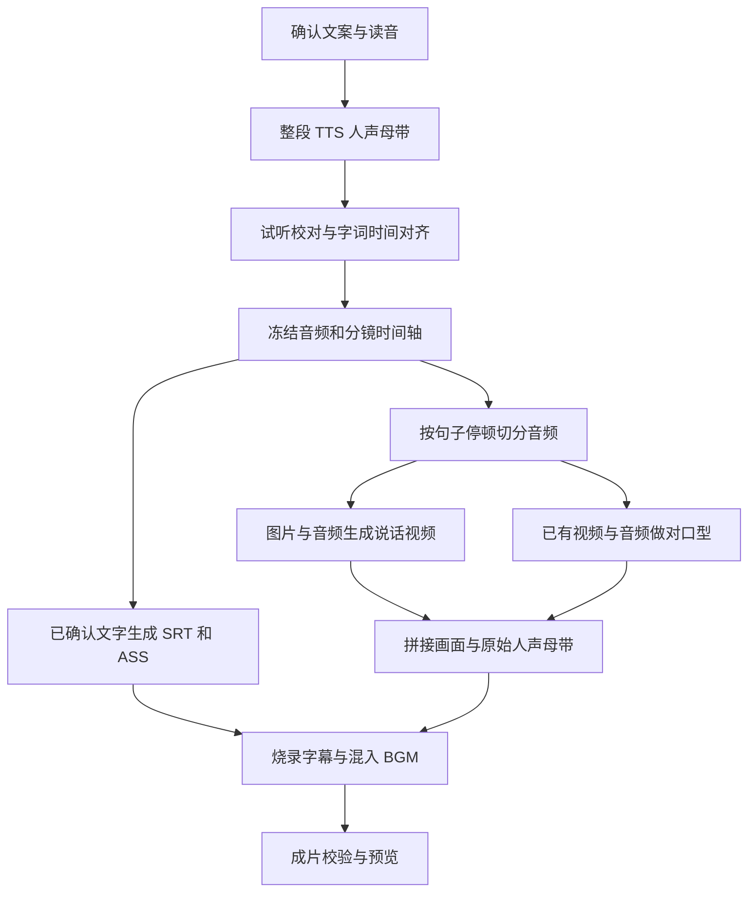

# 营销影像 R1 / R2：配音、字幕与对口型方案

日期：2026-10-20。对应 [营销影像评审 R1 / R2](marketing-video-review-20261019.html#architecture)。状态：设计建议。TTS 逐镜配音已于 2026-10-21 实施为「数字分身旁白」；旁白模式的本地字幕已于 2026-10-22 实施（[评审报告第九轮](marketing-video-review-20261019.html#fixes9)）：字幕取自确认文案，时间来自每镜配音实测时长和静音停顿，没有字级时间戳和整段时间轴，未做 SRT 导出和只改字幕重新合成。其余部分未实施，未调用付费模型。服务能力与价格按本文日期核对官方文档，音质和口型效果仍需样片评测。

## 建议决策

采用「确认文案 → 整段 TTS → 校对和时间对齐 → 音频驱动画面 / 对口型 → 本地字幕与混音」路线。配音文件是全流程的统一时间基准。

首个 TTS 适配器建议选 **阿里云百炼 CosyVoice**，先评测 `cosyvoice-v3.5-plus`；豆包语音合成 2.0 作为中文音色对照候选；有海外配音需求时再评测 ElevenLabs。这个顺序根据时间戳接口、接入范围和费用判断，不代表已经通过音质盲测。

当前每镜必须人物出镜，所以完整解决 R1 必须包含对口型。只有 TTS 和字幕时，可交付配音试听与字幕预览，不能把直接换音轨的说话视频标记为口型已修复。

## 1. 当前问题与改造边界

| 项目 | 当前实现 | 本方案 |
| --- | --- | --- |
| R1 配音 | `prompt.ts` 要求每镜读台词；`run.ts` 分镜独立调用视频模型。音色样例只约束声音身份 | 全片固定供应商、模型、音色、语速与读音规则，先获得独立的人声母带 |
| R2 字幕 | `prompt.ts` 要求视频模型画字幕；`media.ts` 认为字幕已经在画面中 | 生成无字幕底片；使用已确认文字和真实音频时间戳生成可编辑字幕，最后烧录 |
| 对口型 | 参考音色不等于最终台词音频；实拍模式未开放 | 人物画面明确接收最终音频片段，单独记录生成 / 对口型任务 |
| 时长 | `duration_sec` 是 4–15 秒整数；口播预算按字数估算 | 区分供应商请求秒数与剪辑时间轴毫秒数；用实测音频验证可行性 |
| TTS 接口 | `core/providers/tts.ts` 只有 `StubTTSProvider`，结果仅含 URL 和字符数 | 增加真实适配器、音频资产、时间戳、用量和恢复记录 |

当前带生成参考视频的路径会设置 `generate_audio: false`。新路径应把「视频模型是否产声」与「成片是否有旁白」拆成两个配置。关闭原生声音不能同时关闭独立 TTS。Kling 的音色 ID 也不能直接充当其他 TTS 服务的音色 ID。

## 2. 制作流程

### 2.1 文案与配音

1. 保存显示文案 `displayText`、朗读文本 `spokenText` 和两者的字符区间映射。例如显示「¥199」，朗读「一百九十九元」。品牌、多音字、电话、英文缩写和单位支持读音修正；不能以读音修正为由擅自修改营销事实。
2. 在当前 15–60 秒产品范围内，优先整段合成一次，保留句间停顿，使跨镜音色和语气连续。供应商输入限制不允许整段时，再按语义段拆分并固定音色与参数。
3. 保存原始回执、可解码的无损人声文件和字词时间戳。内部使用 PCM/WAV，按供应商要求导出音频，不反复 MP3 编解码。合成成功后下载到自有私有资产存储，不能只保留会过期的结果 URL。
4. 先试听品牌、价格、数字和整段节奏，再进行昂贵的视频制作。ASR 可辅助检查漏读、多读、错读；发现差异时标记待校对，不能自动把字幕改成 ASR 识别结果。
5. 原生时间戳缺失或覆盖不完整时，用「最终音频 + 已确认朗读文本」做强制对齐；强制对齐只确定时间，不能证明音频读对了。对齐能力未接入时明确报缺失，不按字数均摊伪造时间戳。当前参考分析 ASR 只有转写，不能直接当作字级对齐服务。

### 2.2 时长与分镜

先有语义分镜，再用实际音频确定时间边界。按停顿和句子边界切音频，不能把一句话机械切成固定 15 秒，更不能切断音节。

- 每镜保留 `audioStartMs / audioEndMs / timelineStartMs / durationMs`；全片保留采样率、音频哈希、字词边界和字幕版本。
- 供应商整数秒请求单独保存为 `requestedDurationSec`。例如剪辑片段需要 7.42 秒，可请求 8 秒底片，再在对口型之前裁成所需长度；生成费用按真实供应商计量，不能按 7.42 秒估算成 8 秒请求的费用。
- 时间轴按最终帧率量化，并同步处理边界静音；不能逐镜舍入后让全片累计漂移。产品时长目标、最长 65 秒和所选模型单镜上限继续在视频付费前检查。
- 某句超过单镜上限时，先调整分镜边界或经用户确认精简文案。全片不满足目标时，允许用户调整语速后重新试听；不要自动大幅加速，也不要先付费生成视频再截掉台词。
- 任何改速、补静音、切分都要先更新母带与时间轴，再提交对口型。对口型完成后不再单独改变声音或画面的速度。

### 2.3 字幕

字幕内容来自已确认的 `displayText`，时间来自与音频对齐的 `spokenText`，通过映射处理数字与缩写。数据源保存为带版本的 JSON，再导出 SRT、ASS；字幕样式与断行可独立修改。

中文按语义断行，英文按词断行。默认最多两行，结合实际字体宽度与安全区排版；品牌、数字与单位尽量不断开。提供字体、位置、大小和样式预览，检查 9:16、16:9、1:1。字幕字符覆盖、顺序、时间单调性和越界必须自动检查。

新路径要求视频模型不生成字幕，仍需抽帧检查是否意外出现文字。旧成片已经画进像素的错字不能靠叠加一层新字幕可靠修复，需重新取得干净底片。仅改字幕样式或显示格式时，复用底片与人声重新渲染；改变实际台词则使配音及对应口型失效。

使用 FFmpeg 的 `subtitles` / ASS 能力完成烧录，输出 MP4、SRT、ASS 和人声音频。烧录需重新编码视频，当前最终合成的 `-c:v copy` 不能照搬。FFmpeg 官方要求字幕滤镜构建包含 libass；部署还需固定中文字体，并在付费前执行包含中英字幕的探针渲染。[FFmpeg 官方文档](https://ffmpeg.org/ffmpeg-filters.html#subtitles-1)

## 3. 对口型的两条路径

| 输入场景 | 建议路径 | 适用边界 |
| --- | --- | --- |
| 只有人物照片，主要做主播讲解 | 人物图片 + 最终 TTS 片段 → 音频驱动视频；先评测 `wan2.2-s2v` | 省去先生成视频再改口型的一次处理。动作、产品互动和场景还原需另验，不能假定等同于当前复杂分镜 |
| 已有实拍，或需要保留 Grok / Kling 的画面和动作 | 原视频 / 生成底片 + 最终 TTS 片段 → VideoRetalk | 保留既有视频生成链路，追加口型步骤；产生额外费用，也可能影响脸部细节 |

万相 `wan2.2-s2v` 支持图片与人声音频输入，输出 480p / 720p，单段音频必须小于 20 秒；北京地域 720p 刊例价为 0.9 元/秒。首版可把单镜限制设为不超过当前 15 秒，并针对图片先做官方检测。其 720p 输出不能宣称为原生 1080p。[万相接口](https://help.aliyun.com/zh/model-studio/wan-s2v-api)、[图片检测与制作流程](https://help.aliyun.com/en/model-studio/wan-s2v-overview/)

VideoRetalk 接收人物视频和独立音频，要求两者时长均大于 2 秒且小于 120 秒，适合逐镜处理和未来实拍模式；要求正面近景、清晰人声。特别注意：音频更长时，默认设置会截断音频，开启扩展则会正倒放循环画面。因此必须先把输入时间对齐，不把供应商默认扩展当作正常剪辑策略。[VideoRetalk 官方接口](https://help.aliyun.com/zh/model-studio/videoretalk-api)

腾讯云「视频免训练」可作为对照候选，明确支持 `OriginalVoice + InputAudioUrl` 音频驱动，但需小时包或并发资源。评测时使用外部 TTS 音频，保持同一声音基准；不能改成文本驱动后让服务再合成另一条声音。[腾讯云视频免训练接口](https://cloud.tencent.com/document/product/1240/116222)

对口型输入只使用干净人声，BGM 最后加入。返回视频先验时长、起始偏移和脸部结果，再复用已确认母带做最终混音。最终关闭原生生成语音，避免双重人声。嘴部遮挡、快速转头、人脸过小或多人物镜头应在付费前提示调整；模型仍可能失败，必须允许单镜重做。

## 4. TTS 云服务推荐

以下价格是查询时官方页面列示的 API 单价，地区、套餐和计费字符口径分别核对；不含音色复刻、对齐、存储、对口型或视频费用。推荐是工程选型建议，不是实测排名。

| 推荐顺序 | 云服务 | 与本项目相关的能力 | 接入注意 | 参考价格 |
| --- | --- | --- | --- | --- |
| 1 | 阿里云百炼 CosyVoice | 有音色复刻与字级时间戳，可把配音和字幕时间一起取得 | `word_timestamp_enabled=true` 仅流式输出可用；还要选择支持时间戳的模型 / 音色组合。不要混用智能语音交互 ISI 的参数和百炼接口 | 北京：v3.5-plus 1.5 元/万字符，v3.5-flash 0.8 元/万字符；v3-plus 2 元/万字符 |
| 2 | 火山引擎豆包语音合成 2.0 | 中文营销配音的音色对照候选；2.0 支持返回字级字幕时间 | 使用 `seed-tts-2.0` 对应音色与 `enable_subtitle=true`；此字幕能力当前仅中英文，不能从语音支持语种推断字幕支持语种 | 语音合成 2.0 后付费 3 元/万字符；复刻音色另核开通和槽位费用 |
| 3 | ElevenLabs | 海外配音候选，`with-timestamps` 返回原文及规范化文本的字符对齐 | 固定模型与 voice ID；对接口和所选音色做中文 / 目标语言实测，不能假定所有模型选项等价 | API 页面：Multilingual v2 / v3 0.08 美元/千字符，Flash / Turbo 0.04 美元/千字符 |

CosyVoice 的模型、音色与流式时间戳限制见 [HTTP API](https://help.aliyun.com/zh/model-studio/cosyvoice-tts-http-api)，价格见 [百炼模型价格](https://help.aliyun.com/zh/model-studio/model-pricing)。首轮用 Plus 做质量基准，再比较 Flash 是否满足验收，不能仅因更便宜就切换。

豆包 2.0 的参数见 [双向流式语音合成](https://docs.volcengine.com/docs/DoubaoVoice/bidirectional-streaming-text-to-speech-websocket?lang=zh)，价格见 [计费说明](https://docs.volcengine.com/docs/DoubaoVoice/Billinginstructions-21?lang=zh)。旧 V3 文档中 `enable_timestamp` 属于 1.0 路径，2.0 使用 `enable_subtitle`；异步字幕事件应完整收齐并校验，不能仅收到最后一块音频就认定时间轴完整。

ElevenLabs 的对齐字段见 [Create speech with timing](https://elevenlabs.io/docs/api-reference/text-to-speech/convert-with-timestamps)，价格见 [ElevenAPI Pricing](https://elevenlabs.io/pricing/api)。本次直接打开价格页与搜索摘要有差异，采用直接打开页面的上述价格；采购时再次按账号确认。

费用量级示例：若一次请求按供应商规则计为 300 个计费字符，CosyVoice v3.5-plus 约 0.045 元，豆包 2.0 约 0.09 元；这是字符费用示例，不等同于每分钟价格。相比之下，60 秒万相 720p 音频驱动视频按 0.9 元/秒约 54 元。优先在视频生成前完成配音校对，通常比单纯压低 TTS 单价更有价值；该比较不含底片生成及其他服务费用。

## 5. 仓库改造清单

以下是计划新增的能力，不是当前已实现的行为。沿用固定流程和现有任务系统即可，不需要引入通用 DAG。

| 位置 | 计划改造 |
| --- | --- |
| `packages/core/src/providers/tts.ts` | 定义语言、音色、语速、读音、取消信号、字词对齐与实际用量契约；存储与凭证由 server 管理 |
| `packages/core/src/marketing-video/index.ts`、`models.ts` | 增加制作模式和版本化时间轴；区分原生声音、独立旁白、本地字幕、图片音频驱动和视频对口型能力 |
| `packages/server/src/marketing-video/` | 新增 TTS / 对齐 / 字幕 / 对口型适配与阶段服务；在 `run.ts` 中按音频、画面、口型、合成阶段执行和恢复 |
| `prompt.ts`、`creation.ts` | 新路径生成无字幕底片，按口型服务所需人物动作约束生成画面；独立 TTS 的台词不再交给视频模型朗读 |
| `media.ts` | 接收主音轨及时间轴，精确切分，移除原生人声，烧录字幕，加入 BGM 压低与响度控制；扩展探针与校验 |
| `repository.ts`、新数据库迁移 | 保存音频版本、阶段回执、供应商任务、原始用量、字幕、口型结果与依赖哈希；不得修改旧迁移 |
| `routes.ts`、前端 `ProductionStep.tsx` / `ResultPanel.tsx` | 配音试听、读音修正、字幕预览、分阶段进度、只重做失败阶段；显示费用影响并保持中英界面一致 |

数据库当前片段时长是整数列。新剪辑时间轴应新增毫秒字段或版本化 JSON，不能直接把小数塞进旧列，也不能重新解释已冻结任务。新任务明确记录制作版本、供应商和模型；旧原生模式按原输入恢复。

阶段建议保存 `pending → submitting → running → succeeded / failed / unknown`。每次付费请求先持久化意图，回执和音频落盘后再宣布成功；TTS 流式连接中断且结果不完整也可能已收费，不能因没有外部任务 ID 就自动重发。已知任务只继续查询 / 下载；未知状态沿用现有明确释放机制，不自动切到另一家重新收费。

缓存及复用按用户隔离，键至少包含文本、读音规则、供应商、模型、音色版本、语速和输出设置。现有 TokenHub 是否代理对应 TTS / 对口型接口需另查，不能假定已有 Qwen ASR 凭证就能调用百炼直连接口。所有资产、音色与用量绑定用户；私有素材通过适配器可读取的短期链接传递，保留现有 SSRF、文件格式与大小校验、取消能力。

| 修改内容 | 需要重做 |
| --- | --- |
| 字幕颜色、位置、断行、相同读音的显示格式 | 字幕和最终合成；复用人声及口型视频 |
| BGM 或音量 | 最终混音和合成 |
| 单镜画面 | 该镜画面、该镜口型和最终合成 |
| 台词、音色、语速、读音 | 配音及对齐；根据音频片段哈希判定口型失效范围 |

首版采用整段 TTS 时，改一句也可能使整段语音和后续节奏改变，不能承诺只重做这一镜。以后若实现有上下文的局部配音替换，再按依赖范围复用；视频片段不能仅凭镜号相同就复用。

## 6. 实施顺序与验收

| 阶段 | 交付 | 完成标准 |
| --- | --- | --- |
| A：配音和字幕基座 | 首个 TTS、试听、读音规则、真实时间戳、SRT/ASS、本地字幕预览、回执恢复 | 无漏字、多字、读音未校对项；可单独改字幕并重新渲染。本阶段不宣称解决人物口型 |
| B：人物成片 | 先接一种音频驱动 / 对口型服务，接通全片音频时间轴，提供单镜预览与重做 | 每镜人物和声音匹配，声音连续，字幕可编辑；R1 / R2 经真实样片验收后才关闭 |
| C：扩展与成本优化 | 第二 TTS、另一条人物路径、实拍模式、局部重配、质量与费用看板 | 切换供应商不破坏时间轴、归属或计费；按失败阶段恢复 |

首轮使用同一批至少 30 条已授权样片对比：覆盖 15 / 30 / 60 秒、品牌多音字、价格电话、中英混读、跨镜停顿、正脸与转头。固定脚本和人物素材后做盲评，记录错读率、字幕误差、口型观感、脸部失真、成功率、耗时和实际费用。

建议初始验收门槛如下，属于项目目标，须通过样片校准，不是供应商承诺：

- 关键事实、品牌、价格和数字人工核对全部正确；字幕文字与确认稿一致，允许已记录的显示 / 朗读形式差异。
- 抽检字幕边界误差 P95 不超过 150 毫秒；无越界、重叠、漏句、字体缺字和安全区遮挡。
- 人工标注的口型偏移绝对值 P95 目标不超过 100 毫秒；同时检查牙齿、嘴部形变和人物身份，时间偏移合格不代表视觉质量合格。
- 无截断台词、双重人声或 BGM 遮蔽人声；合成总时长符合已冻结时间轴。
- 模拟 TTS 断流、字幕缺失、Worker 重启、供应商回执丢失、取消和再次进入；确认不会重复提交未知付费请求，成功阶段可复用。

本次仅核对现有代码、方案中的本地引用和官方资料，未开通供应商、未做真实配音 / 口型评测，也未变更运行时代码。
